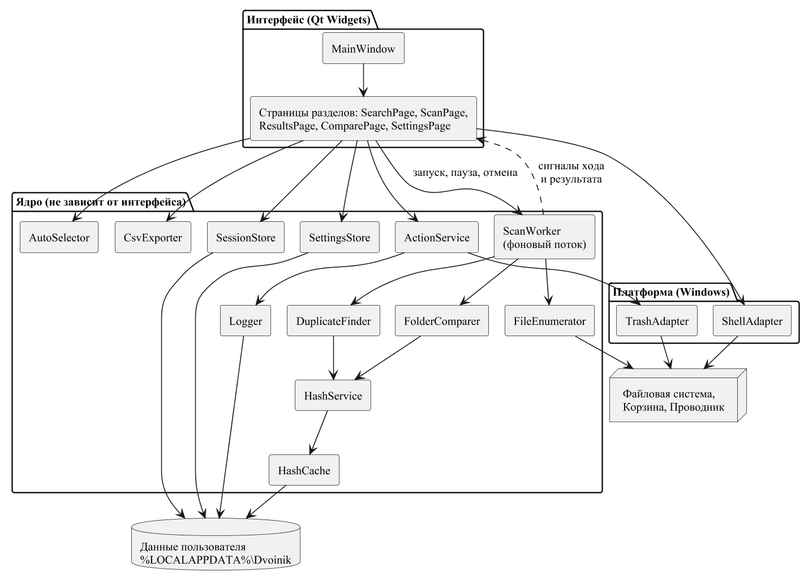
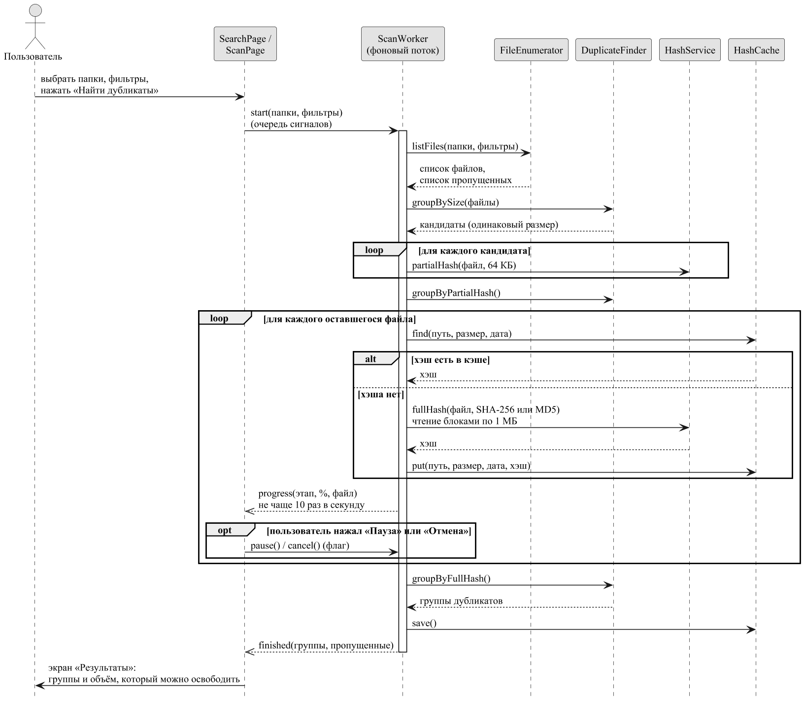
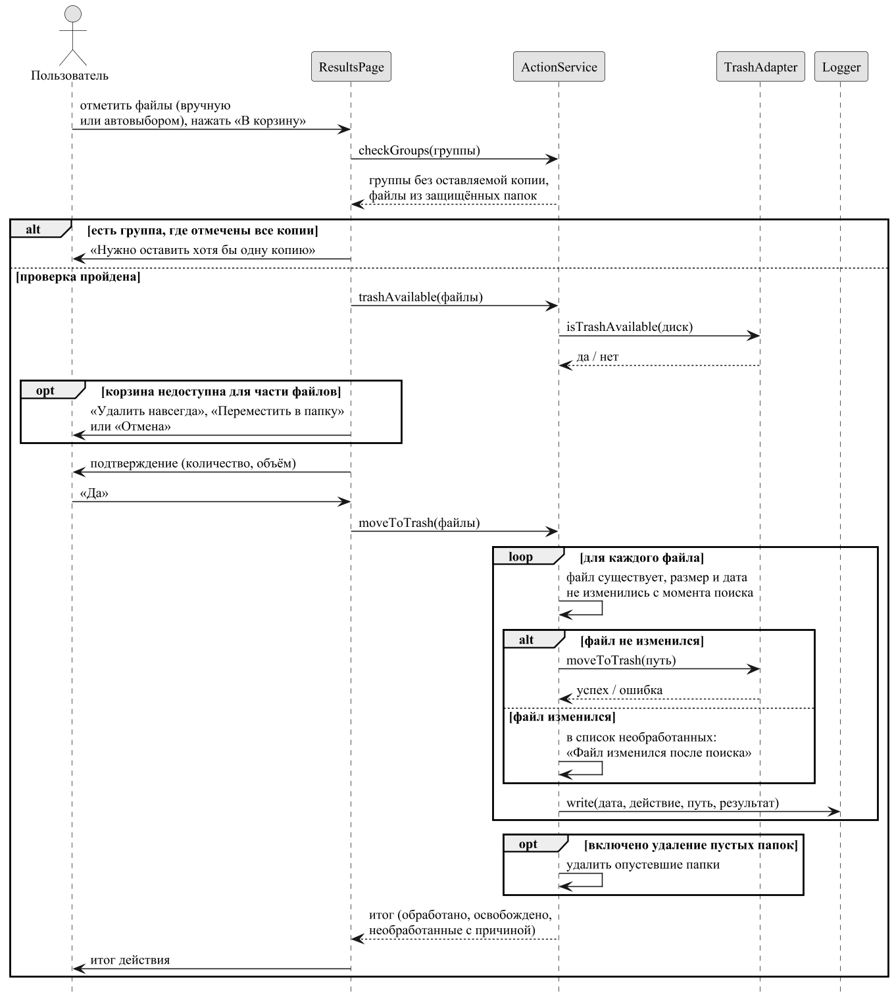

# Описание дизайна программного обеспечения

Для приложения поиска дубликатов файлов «Двойник»

Версия 0.3

Подготовил Левшук Д.Д., гр. 434701

Кафедра ЭВМ, БГУИР

18.12.2026

## Оглавление

<!-- TOC -->
* [1. Введение](#1-introduction)
  * [1.1 Назначение документа](#11-document-purpose)
  * [1.2 Область применения](#12-subject-scope)
  * [1.3 Определения, акронимы и сокращения](#13-definitions-acronyms-and-abbreviations)
  * [1.4 Ссылки](#14-references)
  * [1.5 Обзор документа](#15-document-overview)
* [2. Обзор дизайна](#2-design-overview)
  * [2.1 Задачи стейкхолдеров](#21-stakeholder-concerns)
  * [2.2 Выбранные точки зрения](#22-selected-viewpoints)
* [3. Проектные представления](#3-design-views)
* [4. Решения](#4-decisions)
* [5. Приложения](#5-appendixes)
<!-- TOC -->

## История изменений

<!-- table: История изменений -->
| Name | Date | Reason For Changes | Version |
|------|------|--------------------|---------|
| Левшук Д.Д. | 20.11.2026 | Первая версия по согласованной SRS | 0.1 |
| Левшук Д.Д. | 24.11.2026 | Итоги первого раунда с Заказчиком: кэш в бинарном файле (ADR-0007 заменяет ADR-0004), предпросмотр через системную программу, сравнение папок на общем ядре | 0.2 |
| Левшук Д.Д. | 18.12.2026 | Итоги второго раунда: защищённые папки, удаление пустых папок, сохранение сеанса (компонент SessionStore), пауза возвращена в план | 0.3 |

---

## 1. Введение {#1-introduction}

### 1.1 Назначение документа {#11-document-purpose}

Документ описывает, как будет устроено приложение «Двойник»: из каких частей оно состоит, как части взаимодействуют, где хранятся данные и почему выбраны именно такие решения. Документ предназначен для разработчиков проекта (включая подключаемого junior-разработчика) и преподавателя. Он построен на основе согласованной спецификации требований `srs/srs.md` (лабораторная работа №3); идентификаторы требований `REQ-…` взяты из неё без изменений.

### 1.2 Область применения {#12-subject-scope}

Проектируется настольное приложение «Двойник» версии 1.0 для Windows 10/11 (x64). Приложение ищет файлы с одинаковым содержимым в выбранных папках, показывает их группами и помогает безопасно удалить лишние копии (по умолчанию — в корзину), а также сравнивает содержимое двух папок.

В документ входят: структура приложения, алгоритм поиска, работа с потоками, хранение кэша, настроек, журнала и сеанса. В документ не входят: работа по сети, поиск похожих (а не одинаковых) изображений и музыки, жёсткие ссылки, пункт в контекстном меню Проводника — эти функции исключены из проекта при согласовании SRS.

### 1.3 Определения, акронимы и сокращения {#13-definitions-acronyms-and-abbreviations}

<!-- table: Термины и сокращения -->
| Term | Definition |
|------|------------|
| ADR | Architecture Decision Record — протокол архитектурного решения |
| SDD | Software Design Description — описание дизайна программного обеспечения |
| SRS | Software Requirements Specification — спецификация требований |
| Группа дубликатов | Два и более файла с полностью одинаковым содержимым |
| Кэш хэшей | Файл, в котором хранятся вычисленные хэши, чтобы не считать их повторно |
| Сеанс поиска | Сохранённый результат поиска (группы и отметки), который можно открыть после перезапуска |
| Хэш | Короткое значение, вычисленное по содержимому файла (SHA-256 или MD5) |
| Хэш начала файла | Хэш первых 64 КБ файла, используется для быстрого отсева |

### 1.4 Ссылки {#14-references}

<!-- table: Ссылки -->
| Документ | Автор | Версия | Расположение | Вид |
|----------|-------|--------|--------------|-----|
| Спецификация требований «Двойник» | Левшук Д.Д. | 0.1 | `srs/srs.md` | Нормативный |
| Протоколы архитектурных решений | Левшук Д.Д. | — | `adr/` | Нормативный |
| Планы реализации v1, v2 | Левшук Д.Д. | — | `plan/` | Справочный |
| IEEE 1016-2009 Software Design Descriptions | IEEE | 2009 | — | Справочный |
| Документация Qt 6 | The Qt Company | 6.5+ | doc.qt.io | Справочный |

### 1.5 Обзор документа {#15-document-overview}

Раздел 2 перечисляет заинтересованные стороны и выбранные точки зрения. Раздел 3 содержит проектные представления с идентификаторами `NNN-название` и ссылками на требования SRS. Раздел 4 кратко перечисляет решения, полные протоколы лежат в каталоге `adr/`. В приложениях приведены системные требования, таблица трассируемости и риски. Изменения документа фиксируются в таблице «История изменений» с увеличением версии.

---

## 2. Обзор дизайна {#2-design-overview}

### 2.1 Задачи стейкхолдеров {#21-stakeholder-concerns}

<!-- table: Заинтересованные стороны и их задачи -->
| Стейкхолдер | Основные задачи | Где отражено |
|-------------|-----------------|--------------|
| Пользователь | Не потерять нужные файлы, быстрый поиск, отзывчивое окно | 005, 006, 008, 009, 010 |
| Заказчик (напарник) | Срок, стоимость, приоритет функций | Раздел 4, `plan/` |
| Разработчик (middle) | Понятная структура, критичные функции под контролем | 002, 003, 009 |
| Junior-разработчик | Независимые задачи с понятными границами | 002, 004 |
| Преподаватель | Соответствие шаблонам, трассируемость требований | Приложения Б, В |

### 2.2 Выбранные точки зрения {#22-selected-viewpoints}

Для небольшого настольного приложения выбраны не все пятнадцать точек зрения шаблона, а только те, что отвечают на вопросы из подраздела 2.1:

- Контекст (001) — границы системы и внешние элементы;
- Композиция (002) — слои и компоненты, диаграмма компонентов;
- Логическое представление (003) — основные структуры данных и классы;
- Информация (004) — формат файлов настроек, кэша, журнала и сеанса;
- Взаимодействие (005, 006) — диаграммы последовательности поиска и очистки;
- Алгоритм (007) — трёхэтапный поиск дубликатов;
- Динамика состояний (008) — состояния поиска;
- Параллелизм (009) — фоновый поток, пауза и отмена;
- Развёртывание и ресурсы (010) — портативная поставка, память, диск.

Точки зрения «Физическое представление», «Структура», «Зависимости» и «Паттерны» отдельно не описываются: приложение работает на одном компьютере, а зависимости компонентов видны на диаграмме компонентов.

---

## 3. Проектные представления {#3-design-views}

- **ID:** 001-context
- **Title:** Контекст системы
- **Viewpoint:** Контекст
- **Representation:** Пользователь работает с приложением через главное окно. Приложение взаимодействует только с локальными объектами Windows: файловой системой (обход папок, чтение файлов, перемещение и удаление), корзиной Windows и Проводником (открыть файл, показать файл в папке). Сеть не используется, права администратора не требуются. Данные приложения хранятся в `%LOCALAPPDATA%\Dvoinik`. Схема контекста приведена в SRS (`srs/images/context.png`).
- **More Information:** REQ-SEC-001, REQ-SEC-002, REQ-SEC-004, REQ-AVAIL-001.

- **ID:** 002-composition
- **Title:** Слои и компоненты
- **Viewpoint:** Композиция
- **Representation:** Приложение разделено на три слоя. Слой интерфейса знает о ядре, ядро не знает об интерфейсе, платформенный слой изолирует вызовы Windows. Состав компонентов приведён в таблице 3.1, диаграмма — на рисунке 3.1.
- **More Information:** REQ-MAINT-001, REQ-INT-001. Решения ADR-0001, ADR-0003.

<!-- table: Компоненты системы -->
| Компонент | Ответственность | Слой | Требования |
|-----------|-----------------|------|------------|
| MainWindow | Главное окно, боковое меню, переключение разделов | Интерфейс | INT-001, INT-002 |
| SearchPage, ScanPage, ResultsPage, ComparePage, SettingsPage | Страницы разделов «Поиск», «Сканирование», «Результаты», «Сравнение папок», «Настройки» | Интерфейс | INT-003 – INT-006, FUNC-008, FUNC-011 – FUNC-013 |
| ScanWorker | Выполняет поиск и сравнение в фоновом потоке, сообщает о ходе, обрабатывает паузу и отмену | Ядро | INT-003, FUNC-008 – FUNC-010, FUNC-024 |
| FileEnumerator | Обход папок с подпапками, фильтры, исключения, скрытые файлы, список пропущенных | Ядро | FUNC-001 – FUNC-006, REL-002 |
| HashService | Хэш начала файла и полный хэш (SHA-256 или MD5), чтение блоками по 1 МБ | Ядро | FUNC-007, PERF-002, PERF-004 |
| DuplicateFinder | Группировка по размеру, хэшу начала и полному хэшу | Ядро | FUNC-007 |
| FolderComparer | Сравнение двух папок по содержимому на общем ядре | Ядро | FUNC-023 |
| HashCache | Хранение хэшей между запусками в бинарном файле | Ядро | FUNC-022, PERF-003, REL-003 |
| AutoSelector | Правила автовыбора лишних копий | Ядро | FUNC-014 |
| ActionService | Проверки перед действием, корзина, перенос, удаление, защита последней копии, защищённые папки, удаление пустых папок | Ядро | FUNC-015 – FUNC-020, FUNC-027, FUNC-028, REL-001, SEC-003 |
| CsvExporter | Экспорт результатов в CSV | Ядро | FUNC-021, COMP-002 |
| SettingsStore | Чтение и запись настроек | Ядро | FUNC-025, FUNC-026, REL-003 |
| Logger | Журнал действий над файлами, хранение 30 дней | Ядро | OBS-001 |
| SessionStore | Сохранение и загрузка сеанса поиска | Ядро | FUNC-029 |
| TrashAdapter | Перемещение в корзину, проверка доступности корзины для диска | Платформа | FUNC-016, FUNC-017 |
| ShellAdapter | Открытие файла программой по умолчанию, показ файла в Проводнике | Платформа | FUNC-012 |

- **ID:** 003-logical
- **Title:** Основные структуры данных
- **Viewpoint:** Логическое представление
- **Representation:** Ядро работает с тремя простыми структурами. `FileEntry` — один найденный файл: путь, размер, дата изменения, хэш, признак «отмечен». `DuplicateGroup` — группа дубликатов: размер одного файла, хэш, список `FileEntry`; объём, который можно освободить, считается как размер × (число файлов − 1). `ScanOptions` — параметры поиска: список папок, исключённые папки, фильтр по типу и размеру, учёт скрытых файлов, алгоритм хэша, использование кэша. Сравнение папок возвращает `CompareResult` из трёх списков: «Есть в обеих», «Только в A», «Только в B».
- **More Information:** REQ-FUNC-007, REQ-FUNC-011, REQ-FUNC-023.

- **ID:** 004-information
- **Title:** Хранимые данные
- **Viewpoint:** Информация
- **Representation:** Все файлы лежат в `%LOCALAPPDATA%\Dvoinik` (таблица 3.2). При ошибке чтения файл настроек, кэша или сеанса создаётся заново со значениями по умолчанию.
- **More Information:** REQ-SEC-004, REQ-REL-003, REQ-FUNC-022, REQ-FUNC-026, REQ-OBS-001, REQ-FUNC-029. Решения ADR-0006, ADR-0007.

<!-- table: Файлы данных приложения -->
| Файл | Формат | Содержимое |
|------|--------|------------|
| `settings.ini` | INI (QSettings) | Настройки, список папок, фильтры, исключённые и защищённые папки |
| `cache.bin` | Бинарный (QDataStream) | Заголовок «DVHC», версия формата, число записей; записи: путь, размер, дата изменения, алгоритм, хэш |
| `session.dat` | Бинарный (QDataStream) | Параметры поиска, группы дубликатов, отметки файлов |
| `log\ГГГГ-ММ-ДД.log` | Текст UTF-8 | Строка на действие: дата и время; действие; исходный путь; путь назначения; результат. Файлы старше 30 дней удаляются при запуске |

- **ID:** 005-interaction-search
- **Title:** Сценарий «Поиск дубликатов»
- **Viewpoint:** Взаимодействие
- **Representation:** Пользователь запускает поиск на странице «Поиск». Страница передаёт параметры объекту ScanWorker, который работает в фоновом потоке, и переключается на страницу «Сканирование». ScanWorker получает список файлов, группирует их по размеру, считает хэш начала файла, затем полный хэш (сначала ищет его в кэше) и передаёт в интерфейс ход поиска не чаще десяти раз в секунду. По окончании интерфейс получает группы и список пропущенных файлов. Диаграмма приведена на рисунке 3.2.
- **More Information:** REQ-FUNC-007, REQ-FUNC-008, REQ-INT-003, REQ-PERF-001.

- **ID:** 006-interaction-cleanup
- **Title:** Сценарий «Очистка»
- **Viewpoint:** Взаимодействие
- **Representation:** Пользователь отмечает файлы и выбирает действие. ActionService проверяет, что в каждой группе остаётся хотя бы одна копия и что файлы не лежат в защищённых папках, проверяет доступность корзины, после подтверждения обрабатывает файлы по одному: проверяет, что файл не изменился после поиска, выполняет действие и пишет строку в журнал. В конце пользователь видит итог с причинами необработанных файлов. Диаграмма приведена на рисунке 3.3.
- **More Information:** REQ-FUNC-015 – REQ-FUNC-020, REQ-FUNC-027, REQ-FUNC-028, REQ-REL-001, REQ-SEC-003. Решение ADR-0005.

- **ID:** 007-algorithm
- **Title:** Трёхэтапный поиск дубликатов
- **Viewpoint:** Алгоритм
- **Representation:** Этап 1: файлы группируются по размеру (QHash по размеру), группы из одного файла и пустые файлы отбрасываются. Этап 2: у оставшихся файлов считается хэш первых 64 КБ, файлы группируются по паре «размер, хэш начала», одиночные отбрасываются. Этап 3: у оставшихся считается полный хэш (SHA-256 по умолчанию или MD5 по выбору в настройках); если в кэше есть запись с тем же путём, размером и датой изменения, хэш берётся из кэша. Группы с одинаковым полным хэшем и есть группы дубликатов. Группы сортируются по убыванию объёма, который можно освободить. Ход поиска считается по объёму прочитанных данных. Сравнение папок использует этапы 1–3 для файлов обеих папок и раскладывает результат в три списка.
- **More Information:** REQ-FUNC-007, REQ-FUNC-023, REQ-PERF-002, REQ-PERF-003. Решение ADR-0002.

- **ID:** 008-state
- **Title:** Состояния поиска
- **Viewpoint:** Динамика состояний
- **Representation:** Поиск имеет состояния «Ожидание», «Поиск», «Пауза», «Завершён», «Отменён». Переходы: «Ожидание» → «Поиск» по кнопке «Найти дубликаты»; «Поиск» → «Пауза» по кнопке «Пауза»; «Пауза» → «Поиск» по кнопке «Продолжить»; «Поиск» или «Пауза» → «Отменён» по кнопке «Отмена»; «Поиск» → «Завершён» после третьего этапа. Из «Завершён» и «Отменён» интерфейс возвращается в «Ожидание». Кнопки на странице «Сканирование» включаются и выключаются в зависимости от состояния.
- **More Information:** REQ-FUNC-009, REQ-FUNC-010.

- **ID:** 009-concurrency
- **Title:** Фоновый поток, пауза и отмена
- **Viewpoint:** Параллелизм
- **Representation:** В приложении два потока: поток интерфейса и один рабочий поток QThread, в который перенесён объект ScanWorker. Потоки общаются только сигналами Qt (соединение через очередь), поэтому общих изменяемых данных у них нет. Сигнал хода отправляется не чаще одного раза в 100 мс (QElapsedTimer). Отмена и пауза — два флага QAtomicInt: рабочий поток проверяет их между файлами и между блоками по 1 МБ; при паузе поток ждёт в цикле с `QThread::msleep(100)`. Действия над файлами (корзина, перенос) выполняются в потоке интерфейса: их немного и каждое быстрое.
- **More Information:** REQ-INT-003, REQ-PERF-001, REQ-FUNC-009, REQ-FUNC-010. Решение ADR-0003.

- **ID:** 010-deployment-resources
- **Title:** Поставка и использование ресурсов
- **Viewpoint:** Развёртывание, Ресурсы
- **Representation:** Приложение собирается в Qt Creator (CMake, MSVC 2022 x64) и поставляется папкой, подготовленной утилитой `windeployqt`: `Dvoinik.exe` и библиотеки Qt (динамическая компоновка, LGPL v3). Установка не требуется. Память: в памяти хранятся только сведения о файлах (около 300 байт на файл), поэтому 100 000 файлов занимают десятки мегабайт; файлы читаются блоками по 1 МБ и целиком в память не загружаются; кэш загружается в память при запуске поиска. Диск: файл читается не более двух раз (начало и полный хэш), при попадании в кэш — ни разу.
- **More Information:** REQ-INST-001, REQ-BUILD-001, REQ-COMP-001, REQ-PERF-004.

---

## 4. Решения {#4-decisions}

Полные протоколы оформлены по шаблону `adr/adr-template.md` и лежат в каталоге `adr/`. Перечень решений приведён в таблице 4.1.

<!-- table: Перечень архитектурных решений -->
| ADR | Решение | Статус | Требования |
|-----|---------|--------|------------|
| ADR-0001 | Интерфейс на Qt 6 Widgets | Accepted | INT-001, COMP-001 |
| ADR-0002 | Трёхэтапное сравнение: размер, хэш начала, полный хэш SHA-256 (MD5 по выбору) | Accepted | FUNC-007, FUNC-025, PERF-002 |
| ADR-0003 | Поиск в одном фоновом потоке QThread | Accepted | INT-003, PERF-001 |
| ADR-0004 | Кэш хэшей в базе SQLite | Superseded by ADR-0007 | FUNC-022, PERF-003 |
| ADR-0005 | Корзина через QFile::moveToTrash | Accepted | FUNC-016, FUNC-017 |
| ADR-0006 | Настройки в INI-файле через QSettings | Accepted | FUNC-026, SEC-004 |
| ADR-0007 | Кэш хэшей в бинарном файле | Accepted | FUNC-022, PERF-003, REL-003 |

---

## 5. Приложения {#5-appendixes}

### 5.1 Системные требования уровня архитектуры

Системные требования выведены из SRS и уточняют, как должна быть устроена система. Приоритет указан по шкале 10 (Critical) – 50 (Optional).

<!-- table: Системные требования уровня архитектуры -->
| ID | Системное требование | Источник в SRS | Приоритет |
|----|----------------------|----------------|-----------|
| SYS-001 | Система разделена на три слоя: интерфейс, ядро (поиск, сравнение, действия), платформенный слой (корзина, открытие файла) | INT-001, MAINT-001 | 10 |
| SYS-002 | Поиск и сравнение выполняются в одном фоновом потоке; ход поиска передаётся интерфейсу сигналами не чаще десяти раз в секунду | INT-003, PERF-001, FUNC-008 | 10 |
| SYS-003 | Дубликаты определяются в три этапа: размер файла, хэш начала файла, полный хэш (SHA-256 по умолчанию, MD5 по выбору) | FUNC-007, FUNC-025, PERF-002 | 10 |
| SYS-004 | Файлы читаются блоками по 1 МБ; в памяти хранятся только путь, размер, дата изменения и хэш файла | PERF-002, PERF-004 | 20 |
| SYS-005 | Все действия над файлами выполняются через единый модуль, который перед операцией проверяет наличие файла и наличие другой копии в группе | FUNC-015, REL-001, SEC-003 | 10 |
| SYS-006 | Удаление выполняется в корзину; при её недоступности пользователь получает предупреждение | FUNC-016, FUNC-017 | 10 |
| SYS-007 | Кэш хэшей использует ключ из пути, размера и даты изменения файла; повреждённый кэш пересоздаётся без потери работоспособности | FUNC-022, PERF-003, REL-003 | 30 |
| SYS-008 | Настройки сохраняются в INI-файле в каталоге данных приложения | FUNC-026, SEC-004 | 30 |
| SYS-009 | Каждое действие над файлами записывается в текстовый журнал | OBS-001 | 30 |
| SYS-010 | Приложение не использует сетевые модули и не требует прав администратора | SEC-001, SEC-002, AVAIL-001 | 10 |
| SYS-011 | Проект собирается в Qt Creator с помощью CMake и MSVC 2022 (x64); поставка портативная, без установщика | BUILD-001, INST-001 | 20 |
| SYS-012 | Результаты экспортируются в CSV с разделителем «;» | FUNC-021, COMP-002 | 40 |

### 5.2 Трассируемость требований

Каждое требование SRS отнесено хотя бы к одному компоненту (таблица Б.1). Требования REQ-FUNC-027 – REQ-FUNC-029 добавлены во втором раунде согласования.

<!-- table: Трассируемость «требование – компонент» -->
| Требования | Компоненты | Представление |
|------------|------------|---------------|
| REQ-INT-001, REQ-INT-002 | MainWindow | 002 |
| REQ-INT-003, REQ-PERF-001 | ScanWorker, страницы | 009 |
| REQ-INT-004 – REQ-INT-006 | Страницы разделов | 002 |
| REQ-FUNC-001 – REQ-FUNC-006 | SearchPage, FileEnumerator | 002, 007 |
| REQ-FUNC-007, REQ-PERF-002 | DuplicateFinder, HashService | 007 |
| REQ-FUNC-008 – REQ-FUNC-010 | ScanWorker, ScanPage | 005, 008, 009 |
| REQ-FUNC-011, REQ-FUNC-013 | ResultsPage | 003 |
| REQ-FUNC-012 | ResultsPage, ShellAdapter | 002 |
| REQ-FUNC-014 | AutoSelector | 002 |
| REQ-FUNC-015 – REQ-FUNC-020 | ActionService, TrashAdapter | 006 |
| REQ-FUNC-021, REQ-COMP-002 | CsvExporter | 002 |
| REQ-FUNC-022, REQ-PERF-003, REQ-REL-003 | HashCache | 004, 007 |
| REQ-FUNC-023, REQ-FUNC-024 | FolderComparer, ComparePage | 003, 007 |
| REQ-FUNC-025, REQ-FUNC-026 | SettingsStore, SettingsPage | 004 |
| REQ-FUNC-027, REQ-FUNC-028 | ActionService | 006 |
| REQ-FUNC-029 | SessionStore | 004 |
| REQ-PERF-004 | HashService, FileEnumerator | 010 |
| REQ-SEC-001, REQ-SEC-002, REQ-AVAIL-001 | Вся система (нет сетевых модулей) | 001 |
| REQ-SEC-003, REQ-REL-001 | ActionService | 006 |
| REQ-SEC-004 | SettingsStore, HashCache, Logger, SessionStore | 004 |
| REQ-REL-002 | FileEnumerator | 005 |
| REQ-OBS-001 | Logger | 004 |
| REQ-COMP-001, REQ-INST-001, REQ-BUILD-001 | Сборка и поставка | 010 |
| REQ-COMP-003 | Документация (`srs/`, `sdd/`, `adr/`) | — |
| REQ-MAINT-001, REQ-MAINT-002 | Структура кода | 002 |

### 5.3 Риски

<!-- table: Риски дизайна -->
| Риск | Влияние | Мера |
|------|---------|------|
| Медленный поиск на HDD | Не выполняется REQ-PERF-002 | Хэш начала файла отсекает большинство кандидатов; кэш при повторном поиске |
| Файл изменён, а дата изменения осталась прежней | Устаревший хэш в кэше | Кэш можно отключить и очистить в настройках; перед удалением повторно проверяются размер и дата |
| Корзина недоступна на съёмном диске | Файл будет удалён навсегда | Проверка доступности корзины до действия и отдельное предупреждение (REQ-FUNC-017) |
| Пути длиннее 260 символов | Файл не читается | Файл пропускается и попадает в список пропущенных (REQ-REL-002) |
| Совпадение MD5 у разных файлов | Ложная группа | По умолчанию SHA-256; MD5 только по выбору пользователя |
| Ошибки junior-разработчика | Дефекты в настройках и фильтрах | Обязательная проверка кода; критичные модули (поиск, ActionService) делает middle-разработчик |
