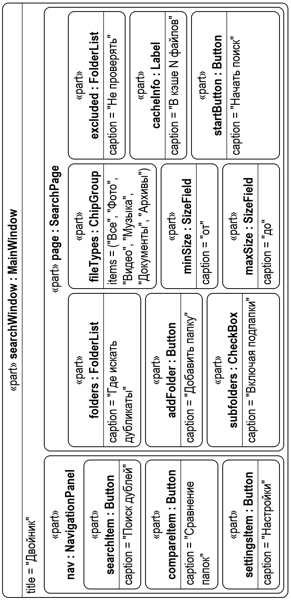
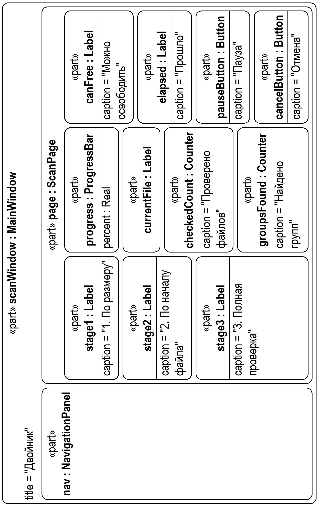
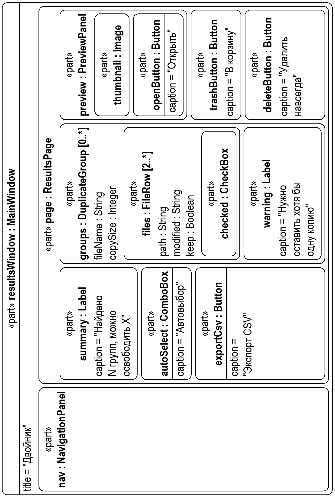
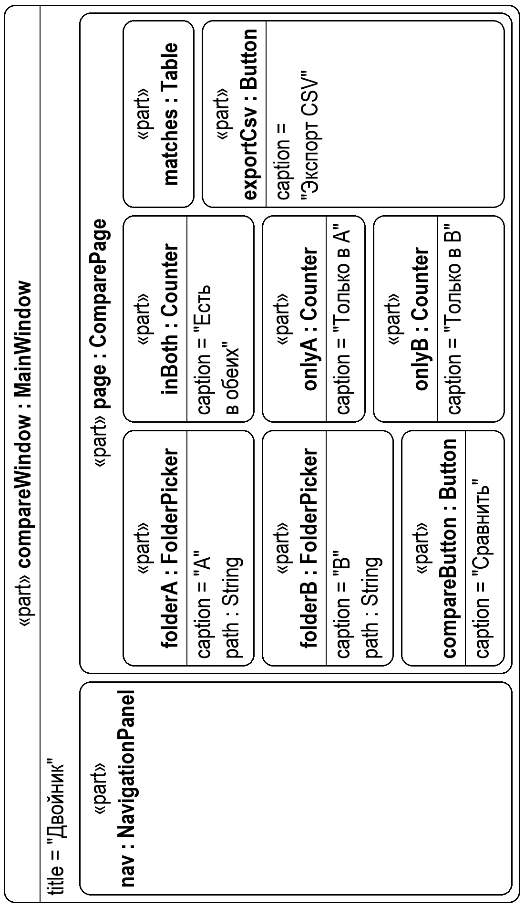
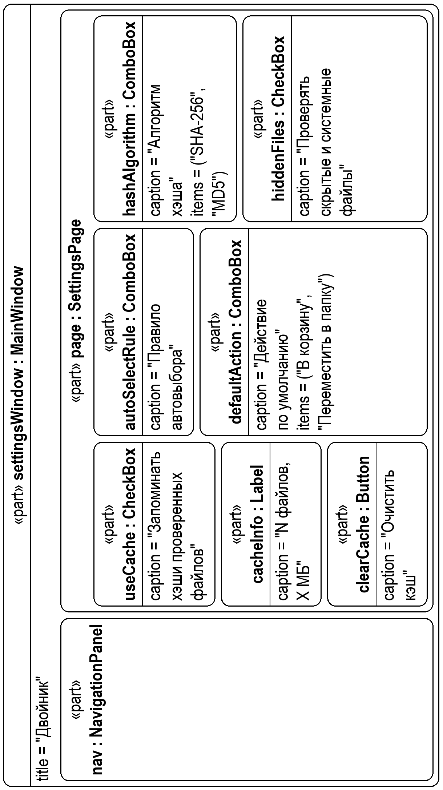
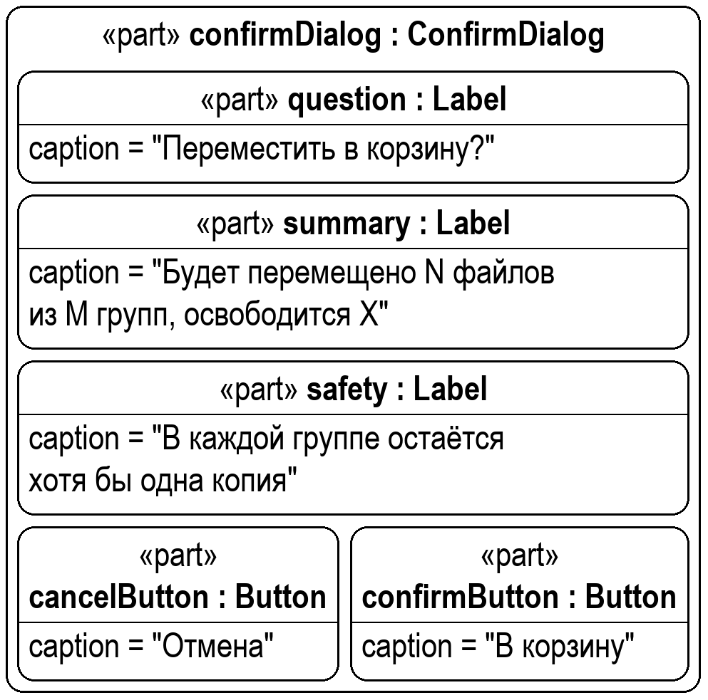

# Спецификация требований к ПО

Для «Двойник» — приложения для поиска дубликатов файлов

Версия 0.1

Подготовил Левшук Д.Д., гр. 434701

БГУИР, кафедра ЭВМ, дисциплина «Жизненный цикл разработки программного обеспечения»

29.10.2026

## Оглавление

<!-- TOC -->
* [1. Введение](#1-introduction)
  * [1.1 Назначение документа](#11-document-purpose)
  * [1.2 Область применения продукта](#12-product-scope)
  * [1.3 Определения, акронимы и сокращения](#13-definitions-acronyms-and-abbreviations)
  * [1.4 Ссылки](#14-references)
  * [1.5 Обзор документа](#15-document-overview)
* [2. Обзор продукта](#2-product-overview)
  * [2.1 Перспектива продукта](#21-product-perspective)
  * [2.2 Функции продукта](#22-product-functions)
  * [2.3 Ограничения продукта](#23-product-constraints)
  * [2.4 Характеристики пользователей](#24-user-characteristics)
  * [2.5 Допущения и зависимости](#25-assumptions-and-dependencies)
  * [2.6 Распределение требований](#26-apportioning-of-requirements)
* [3. Требования](#3-requirements)
  * [3.1 Внешние интерфейсы](#31-external-interfaces)
    * [3.1.1 Пользовательские интерфейсы](#311-user-interfaces)
    * [3.1.2 Аппаратные интерфейсы](#312-hardware-interfaces)
    * [3.1.3 Программные интерфейсы](#313-software-interfaces)
  * [3.2 Функциональные требования](#32-functional)
    * [3.2.1 Поиск дубликатов](#321-search)
    * [3.2.2 Работа с результатами](#322-results)
    * [3.2.3 Дополнительные функции](#323-extra)
  * [3.3 Качество обслуживания](#33-quality-of-service)
    * [3.3.1 Производительность](#331-performance)
    * [3.3.2 Безопасность](#332-security)
    * [3.3.3 Надёжность](#333-reliability)
    * [3.3.4 Доступность](#334-availability)
    * [3.3.5 Наблюдаемость](#335-observability)
  * [3.4 Соответствие стандартам](#34-compliance)
  * [3.5 Проектирование и реализация](#35-design-and-implementation)
    * [3.5.1 Установка](#351-installation)
    * [3.5.2 Сборка и поставка](#352-build-and-delivery)
    * [3.5.3 Распределение](#353-distribution)
    * [3.5.4 Сопровождаемость](#354-maintainability)
    * [3.5.5 Повторное использование](#355-reusability)
    * [3.5.6 Переносимость](#356-portability)
    * [3.5.7 Стоимость](#357-cost)
    * [3.5.8 Сроки](#358-deadline)
    * [3.5.9 Доказательство концепции](#359-proof-of-concept)
    * [3.5.10 Управление изменениями](#3510-change-management)
  * [3.6 ИИ/МО](#36-aiml)
* [4. Верификация](#4-verification)
* [Список использованных источников](#bibliography)
* [5. Приложения](#5-appendixes)
<!-- TOC -->

## История изменений

<!-- table: Лист регистрации изменений -->
| Name | Date | Reason For Changes | Version |
|------|------|--------------------|---------|
| Левшук Д.Д. | 29.10.2026 | Первая версия: бизнес-цели, функции, требования, макеты интерфейса | 0.1 |
|      |      |                    |         |

---

## 1. Введение {#1-introduction}

Документ описывает требования к настольному приложению «Двойник», которое находит на компьютере пользователя файлы с одинаковым содержимым и помогает безопасно избавиться от лишних копий. Ниже приведены назначение и границы продукта (раздел 1), его общий обзор (раздел 2), проверяемые требования (раздел 3), способы их проверки (раздел 4) и вспомогательные материалы, включая макеты интерфейса (раздел 5).

### 1.1 Назначение документа {#11-document-purpose}

SRS фиксирует, **что** должно делать приложение «Двойник», и служит основой для согласования требований с заказчиком, проектирования, разработки и тестирования. Документ используют:

- заказчик (напарник по лабораторной работе, преподаватель) — для согласования и приёмки требований;
- разработчик — для проектирования и реализации;
- тестировщик — для составления тестов по разделу 4.

Решения о том, **как** реализовать требования, будут описаны в документе архитектуры (каталог `sdd/`) и записях архитектурных решений (каталог `adr/`).

### 1.2 Область применения продукта {#12-product-scope}

«Двойник» версии 1.0 — однооконное настольное приложение для Windows. Оно сканирует выбранные пользователем папки, находит файлы с одинаковым содержимым независимо от их имени, показывает их группами, подсказывает, какие копии можно удалить, и выполняет над ними безопасные действия: перемещение в корзину, перемещение в папку или удаление навсегда. Дополнительно приложение умеет сравнивать две папки и показывать, какие файлы есть в обеих.

Бизнес-цели продукта приведены в таблице 1.1.

<!-- table: Бизнес-цели продукта -->
| ID | Цель | Как продукт её достигает |
|----|------|--------------------------|
| BG-1 | Освободить место на диске пользователя | Находит дубликаты и показывает, сколько места можно освободить |
| BG-2 | Навести порядок в фото, документах и загрузках | Группирует одинаковые файлы и помогает выбрать, какую копию оставить |
| BG-3 | Исключить случайную потерю данных при чистке | Всегда оставляет хотя бы одну копию, по умолчанию использует корзину, просит подтверждение |
| BG-4 | Сократить время на чистку | Автовыбор лишних копий по правилу и кэш для быстрого повторного поиска |
| BG-5 | Проверить полноту резервной копии | Сравнение двух папок: что есть в обеих и что только в одной |

**Входит в продукт:** поиск дубликатов по содержимому в локальных папках, фильтры, просмотр и обработка результатов, экспорт отчёта в CSV, кэш хэшей, сравнение двух папок, настройки.

**Не входит в продукт:**

- поиск *похожих* (а не одинаковых) изображений, видео и музыки;
- работа с сетевыми папками и облачными хранилищами;
- замена дубликатов жёсткими или символическими ссылками;
- поиск файлов с одинаковым именем, но разным содержимым;
- встраивание в контекстное меню проводника;
- проверка по расписанию и фоновая работа;
- версии для операционных систем, кроме Windows.

### 1.3 Определения, акронимы и сокращения {#13-definitions-acronyms-and-abbreviations}

Термины, акронимы и сокращения, используемые в документе, приведены в таблице 1.2.

<!-- table: Термины, акронимы и сокращения -->
| Term | Definition |
|------|------------|
| CSV | Comma-Separated Values — текстовый табличный формат, открывается в Excel |
| MD5 | Алгоритм хэширования (RFC 1321), быстрее SHA-256, используется как альтернатива |
| SHA-256 | Алгоритм хэширования (FIPS 180-4), используется по умолчанию |
| SRS | Software Requirements Specification — документ, описывающий назначение, требования и характер ПО |
| UI | User Interface — визуальная часть приложения, через которую пользователь взаимодействует с ПО |
| Автовыбор | Автоматическая отметка лишних копий в каждой группе по выбранному правилу |
| Группа дубликатов | Набор из двух и более файлов с одинаковым содержимым |
| Дубликат | Файл, содержимое которого полностью совпадает с содержимым другого файла; имя, путь и дата не учитываются |
| Исключённая папка | Папка, файлы которой не проверяются при поиске |
| Кэш хэшей | Сохранённые результаты вычисления хэшей, позволяющие не пересчитывать их для неизменившихся файлов |
| Корзина | Корзина Windows, из которой файл можно восстановить |
| Освобождаемое место | Суммарный размер отмеченных (или всех лишних) копий |
| Хэш | Короткое значение фиксированной длины, вычисленное по содержимому файла; у одинаковых файлов хэши совпадают |

### 1.4 Ссылки {#14-references}

Документы, на которые опирается спецификация, приведены в таблице 1.3. Их библиографические описания даны в списке использованных источников.

<!-- table: Нормативные и справочные документы -->
| Документ | Владелец | Версия / дата | Расположение | Статус |
|----------|----------|---------------|--------------|--------|
| ISO/IEC/IEEE 29148:2018. Requirements engineering [1] | ISO/IEC/IEEE | 2018 | iso.org | Справочный |
| Шаблон SRS кафедры ЭВМ [2] | Кафедра ЭВМ БГУИР | — | `srs/srs-template.md` | Нормативный |
| Методические указания к лабораторной работе №3 [3] | Кафедра ЭВМ БГУИР | 2026 | выдаётся преподавателем | Нормативный |
| FIPS 180-4. Secure Hash Standard (SHA-256) [4] | NIST | 2015 | nist.gov | Справочный |
| RFC 1321. The MD5 Message-Digest Algorithm [5] | IETF | 1992 | rfc-editor.org | Справочный |
| RFC 4180. Common Format and MIME Type for CSV Files [6] | IETF | 2005 | rfc-editor.org | Справочный |
| Qt 6 Documentation [7] | The Qt Company | 6.x | doc.qt.io | Справочный |
| Макеты интерфейса | Левшук Д.Д. | 0.1 | `srs/images/` | Нормативный |

### 1.5 Обзор документа {#15-document-overview}

Раздел 2 описывает продукт в целом: место среди других программ, основные функции, ограничения, пользователей и допущения. Раздел 3 содержит проверяемые требования с уникальными идентификаторами вида `REQ-[AREA]-[NNN]`. Раздел 4 содержит матрицу верификации, раздел 5 — макеты интерфейса. Ключевые слова: «должна» — обязательное требование, «следует» — желательное, «может» — необязательное. Все изменения документа фиксируются в основной ветке main репозитория и в таблице «История изменений» с увеличением версии.

---

## 2. Обзор продукта {#2-product-overview}

### 2.1 Перспектива продукта {#21-product-perspective}

«Двойник» — новый самостоятельный продукт, разрабатываемый в рамках курсового проекта по дисциплине ЖЦРПО. Он не является частью другой системы и работает полностью локально, без подключения к интернету. Приложение взаимодействует только с:

- файловой системой Windows — чтение папок и файлов, перемещение и удаление файлов;
- корзиной Windows — перемещение в неё удаляемых файлов;
- проводником Windows — открытие файла и показ его в папке.

```
 Пользователь ──► «Двойник» ──► Файловая система (локальные диски)
                     │
                     ├──► Корзина Windows
                     └──► Проводник Windows (открыть / показать в папке)
```

Владелец продукта и разработчик — Левшук Д.Д. Продукт не имеет SLA и поставляется «как есть».

### 2.2 Функции продукта {#22-product-functions}

**Поиск дубликатов**
- выбор одной или нескольких папок, в том числе с подпапками;
- фильтры по типу файлов, размеру и исключённым папкам;
- поиск по содержимому с отображением хода поиска, паузой и отменой.

**Работа с результатами**
- просмотр групп дубликатов и объёма места, которое можно освободить;
- предпросмотр файла, открытие и показ в проводнике;
- ручная отметка и автовыбор лишних копий по правилу;
- перемещение в корзину, перемещение в папку, удаление навсегда;
- защита от удаления всех копий файла;
- экспорт результатов в CSV.

**Дополнительно**
- сравнение двух папок по содержимому;
- кэш хэшей для ускорения повторного поиска;
- настройки, сохраняемые между запусками.

### 2.3 Ограничения продукта {#23-product-constraints}

Ограничения, которые накладываются на продукт, приведены в таблице 2.1.

<!-- table: Ограничения продукта -->
| ID | Ограничение | Тип |
|----|-------------|-----|
| CON-1 | Приложение должно быть написано на C++ с использованием фреймворка Qt 6 (модуль Widgets) | Внешнее, обязательное (тема курсового проекта) |
| CON-2 | Приложение должно работать в Windows 10 и Windows 11 (x64) | Внешнее, обязательное |
| CON-3 | Приложение должно иметь одно главное окно; все разделы открываются внутри него | Внешнее, обязательное (пожелание заказчика) |
| CON-4 | Приложение не должно требовать подключения к интернету и прав администратора | Внутреннее, обязательное |
| CON-5 | Интерфейс должен быть на русском языке | Внешнее, обязательное |
| CON-6 | Исходный код должен храниться в репозитории `github.com/vexsfire09/SDLC` | Внешнее, обязательное (методика курса) |
| CON-7 | Код должен быть простым и понятным для студента 3-го курса: без сторонних библиотек, кроме Qt и Windows API | Внутреннее, предпочтительное |
| CON-8 | Изменения, запрошенные заказчиком на занятии, должны вноситься до конца занятия | Внешнее, обязательное (методика курса) |

### 2.4 Характеристики пользователей {#24-user-characteristics}

Приложение рассчитано на одного пользователя компьютера; учётные записи и роли не предусмотрены. Классы пользователей приведены в таблице 2.2.

<!-- table: Классы пользователей -->
| Класс пользователя | Описание | Подготовка | Частота использования | Цель |
|--------------------|----------|------------|-----------------------|------|
| Обычный пользователь | Хранит фото, документы и загрузки, не следит за порядком в папках | Базовые навыки работы с Windows | Раз в несколько месяцев | Освободить место, не потеряв нужное |
| Опытный пользователь | Студент, фотограф или человек с большой медиатекой и резервными копиями | Уверенно работает с файлами и папками | Раз в неделю или месяц | Быстро чистить дубли с помощью автовыбора, сравнивать резервные копии |

Оба класса ожидают понятный интерфейс без специальных терминов и явных предупреждений перед необратимыми действиями.

### 2.5 Допущения и зависимости {#25-assumptions-and-dependencies}

Допущения и зависимости, на которые опирается проект, приведены в таблице 2.3.

<!-- table: Допущения и зависимости -->
| ID | Допущение / зависимость | Влияние, если неверно |
|----|-------------------------|-----------------------|
| AS-1 | Проверяемые папки находятся на локальных дисках (HDD, SSD, USB) с файловыми системами NTFS, FAT32 или exFAT | На других носителях поиск может работать медленно или некорректно |
| AS-2 | У пользователя есть права на чтение проверяемых файлов | Недоступные файлы пропускаются (см. REQ-REL-002) |
| AS-3 | Для дисков с проверяемыми файлами в Windows включена корзина | На съёмных дисках корзины обычно нет, файл удаляется навсегда — пользователь должен быть предупреждён (см. REQ-FUNC-017) |
| AS-4 | Файлы не изменяются другими программами во время поиска и обработки | Результаты могут устареть — перед действием файл проверяется повторно (см. REQ-REL-001) |
| AS-5 | Зависимость: библиотеки Qt 6 распространяются вместе с приложением | Без них приложение не запустится |

### 2.6 Распределение требований {#26-apportioning-of-requirements}

Требования распределены по трём версиям в соответствии с таблицей 2.4. Сроки уточняются по графику лабораторных работ (подраздел 3.5.8).

<!-- table: Распределение требований по версиям -->
| Версия | Содержание | Требования |
|--------|------------|------------|
| 0.1 (минимальная) | Выбор папок, поиск по содержимому, прогресс, просмотр групп, перемещение в корзину, защита последней копии | REQ-FUNC-001–002, 007–011, 013, 015–016, 019–020 |
| 0.2 | Фильтры, предпросмотр, автовыбор, перемещение в папку, удаление навсегда, экспорт CSV | REQ-FUNC-003–006, 012, 014, 017–018, 021 |
| 1.0 | Кэш хэшей, сравнение папок, настройки, журнал действий | REQ-FUNC-022–026, REQ-OBS-001 |

---

## 3. Требования {#3-requirements}

Каждое требование оформлено по шаблону: ID, Title, Statement, Rationale, Acceptance Criteria, Verification Method. Для краткости в функциональных требованиях указана также ссылка на бизнес-цель (BG) и макет.

### 3.1 Внешние интерфейсы {#31-external-interfaces}

#### 3.1.1 Пользовательские интерфейсы {#311-user-interfaces}

Макеты экранов приведены в разделе 5.

- **ID:** REQ-INT-001
- **Title:** Одно главное окно с боковым меню
- **Statement:** Приложение должно иметь одно главное окно с боковым меню из трёх разделов: «Поиск дублей», «Сравнение папок», «Настройки». Выбор раздела должен менять содержимое правой части окна без открытия новых окон. Отдельные окна допускаются только для диалогов подтверждения, выбора папки и сообщений об ошибках.
- **Rationale:** CON-3; простая и понятная навигация.
- **Acceptance Criteria:** При переходе между всеми разделами и во всех сценариях раздела 3.2 не открывается ни одного дополнительного главного окна.
- **Verification Method:** Demonstration

- **ID:** REQ-INT-002
- **Title:** Минимальный размер окна
- **Statement:** Главное окно должно корректно отображаться при размере от 960×600 пикселей и масштабе Windows от 100 до 150 %.
- **Rationale:** Работа на ноутбуках с небольшим экраном.
- **Acceptance Criteria:** При размере 960×600 все элементы видимы, текст не обрезается, кнопки доступны.
- **Verification Method:** Inspection

- **ID:** REQ-INT-003
- **Title:** Интерфейс не зависает во время поиска
- **Statement:** Во время поиска и обработки файлов окно должно оставаться отзывчивым: перемещаться, менять размер и реагировать на кнопки «Пауза» и «Отмена».
- **Rationale:** Поиск на большом диске может длиться минуты; зависшее окно пользователь закроет принудительно.
- **Acceptance Criteria:** Во время поиска по папке с 10 000 файлов окно реагирует на нажатия не позднее чем через 200 мс (см. REQ-PERF-001).
- **Verification Method:** Test

- **ID:** REQ-INT-004
- **Title:** Цветовые обозначения и главное действие
- **Statement:** На каждом экране должно быть не более одной выделенной цветом кнопки главного действия. Опасное действие «Удалить навсегда» должно быть выделено красным цветом, успешный результат — зелёным, предупреждения — красным фоном с текстом.
- **Rationale:** Пользователь сразу видит, что нажимать, и не нажимает опасную кнопку случайно.
- **Acceptance Criteria:** Экраны соответствуют макетам раздела 5.
- **Verification Method:** Inspection

- **ID:** REQ-INT-005
- **Title:** Язык интерфейса и сообщения
- **Statement:** Все надписи и сообщения должны быть на русском языке. Сообщение об ошибке должно говорить, что произошло и что делать дальше, без кодов ошибок и технических терминов.
- **Rationale:** CON-5.
- **Acceptance Criteria:** В интерфейсе нет надписей на других языках, кроме путей и имён файлов.
- **Verification Method:** Inspection

- **ID:** REQ-INT-006
- **Title:** Пустые состояния
- **Statement:** Если поиск не нашёл дубликатов, приложение должно показать сообщение «Дубликаты не найдены» и кнопку «Новый поиск». Если не выбрано ни одной папки, кнопка «Начать поиск» должна показывать подсказку «Добавьте хотя бы одну папку».
- **Rationale:** Пользователь не должен видеть пустой экран без пояснений.
- **Acceptance Criteria:** Оба сценария воспроизводятся и показывают указанные сообщения.
- **Verification Method:** Test

#### 3.1.2 Аппаратные интерфейсы {#312-hardware-interfaces}

Приложение не взаимодействует с оборудованием напрямую. Доступ к накопителям (HDD, SSD, USB-флеш-накопители, карты памяти) осуществляется только через файловую систему Windows. Сетевые диски не поддерживаются (раздел 1.2).

#### 3.1.3 Программные интерфейсы {#313-software-interfaces}

Программные системы, с которыми взаимодействует приложение, приведены в таблице 3.1.

<!-- table: Программные интерфейсы -->
| Система | Версия | Что используется | Ошибки и ограничения |
|---------|--------|------------------|----------------------|
| Файловая система Windows | Windows 10/11 | Обход папок, чтение файлов, атрибуты (размер, дата изменения, скрытый, системный), перемещение и удаление | Нет доступа, файл занят, путь длиннее 260 символов — файл пропускается и попадает в список ошибок |
| Корзина Windows (Shell API) | Windows 10/11 | Перемещение файла в корзину с возможностью восстановления | Если корзина на диске недоступна — предупреждение пользователю (REQ-FUNC-017) |
| Проводник Windows | Windows 10/11 | Открытие файла программой по умолчанию; открытие папки с выделенным файлом | Если программа для типа файла не назначена — сообщение пользователю |
| Qt 6 | 6.5 и выше | Интерфейс, потоки, вычисление хэшей, работа с файлами, сохранение настроек | — |

Приложение не предоставляет программных интерфейсов другим системам и не обменивается данными по сети.

### 3.2 Функциональные требования {#32-functional}

#### 3.2.1 Поиск дубликатов {#321-search}

- **ID:** REQ-FUNC-001
- **Title:** Выбор папок для поиска
- **Statement:** Пользователь должен иметь возможность добавить в список поиска одну или несколько папок через стандартный диалог выбора папки и удалить любую папку из списка. Повторное добавление той же папки или её подпапки не должно создавать дубликат в списке.
- **Rationale:** BG-1, BG-2. Основной сценарий работы.
- **Acceptance Criteria:** Можно добавить три разные папки и удалить одну из них; повторно добавленная папка не появляется в списке второй раз.
- **Verification Method:** Test
- **More Information:** Макет «Настройка поиска» (раздел 5).

- **ID:** REQ-FUNC-002
- **Title:** Поиск с учётом подпапок
- **Statement:** Приложение должно предоставлять флажок «Включая подпапки» (по умолчанию включён). При включённом флажке проверяются файлы во всех вложенных папках, при выключенном — только файлы непосредственно в выбранных папках.
- **Rationale:** Пользователь может хотеть проверить только одну папку без вложенных.
- **Acceptance Criteria:** Дубликат во вложенной папке находится при включённом флажке и не находится при выключенном.
- **Verification Method:** Test

- **ID:** REQ-FUNC-003
- **Title:** Фильтр по типу файлов
- **Statement:** Пользователь должен иметь возможность ограничить поиск категориями: «Все», «Фото», «Видео», «Музыка», «Документы», «Архивы». Можно выбрать несколько категорий одновременно; выбор «Все» снимает остальные.
- **Rationale:** BG-4. Пользователь часто хочет почистить только фото или только видео.
- **Acceptance Criteria:** При выбранной категории «Фото» в результатах есть только файлы с расширениями из этой категории.
- **Verification Method:** Test
- **More Information:** Расширения по категориям: Фото — jpg, jpeg, png, gif, bmp, webp, heic, tif, tiff; Видео — mp4, avi, mkv, mov, wmv, webm; Музыка — mp3, wav, flac, aac, ogg, m4a; Документы — pdf, doc, docx, xls, xlsx, ppt, pptx, txt, rtf, odt; Архивы — zip, rar, 7z, tar, gz. Регистр расширения не учитывается.

- **ID:** REQ-FUNC-004
- **Title:** Фильтр по размеру
- **Statement:** Пользователь должен иметь возможность задать минимальный и максимальный размер проверяемых файлов (в КБ, МБ или ГБ). Минимальный размер по умолчанию — 1 КБ, максимальный не ограничен. Файлы нулевого размера не должны считаться дубликатами никогда.
- **Rationale:** BG-4. Мелкие файлы дают много групп, но почти не освобождают места.
- **Acceptance Criteria:** При минимуме 100 КБ файлы меньше 100 КБ не попадают в результаты; при минимуме больше максимума выводится сообщение «Минимальный размер больше максимального» и поиск не запускается.
- **Verification Method:** Test

- **ID:** REQ-FUNC-005
- **Title:** Исключённые папки
- **Statement:** Пользователь должен иметь возможность указать папки, которые не проверяются, даже если они вложены в выбранные. По умолчанию исключены `C:\Windows` и `C:\Program Files`, `C:\Program Files (x86)`.
- **Rationale:** Удаление системных файлов может нарушить работу Windows и программ.
- **Acceptance Criteria:** Дубликаты внутри исключённой папки не попадают в результаты.
- **Verification Method:** Test

- **ID:** REQ-FUNC-006
- **Title:** Скрытые и системные файлы
- **Statement:** По умолчанию приложение должно пропускать файлы с атрибутами «скрытый» и «системный». В настройках должна быть возможность включить их проверку.
- **Rationale:** Такие файлы обычно принадлежат системе и программам.
- **Acceptance Criteria:** Скрытый дубликат не находится при настройке по умолчанию и находится после её включения.
- **Verification Method:** Test

- **ID:** REQ-FUNC-007
- **Title:** Определение дубликатов по содержимому
- **Statement:** Приложение должно считать файлы дубликатами только при полном совпадении содержимого. Имя, расширение, путь и даты файла при этом не учитываются. Группа дубликатов должна содержать не менее двух файлов.
- **Rationale:** BG-1, BG-3. Совпадение имени не гарантирует одинаковое содержимое, и наоборот.
- **Acceptance Criteria:** Файлы `a.jpg` и `копия.jpg` с одинаковым содержимым попадают в одну группу; файлы `a.txt` и `a.txt` в разных папках с разным содержимым — не попадают.
- **Verification Method:** Test
- **More Information:** Предполагаемый способ: поэтапное сравнение — по размеру, затем по хэшу начала файла, затем по хэшу всего файла (SHA-256 по умолчанию или MD5). Окончательный способ фиксируется в SDD/ADR.

- **ID:** REQ-FUNC-008
- **Title:** Отображение хода поиска
- **Statement:** Во время поиска приложение должно показывать: текущий этап (из трёх), общий прогресс в процентах, путь к проверяемому файлу, количество проверенных файлов, количество найденных групп, объём места, которое можно освободить, и время с начала поиска.
- **Rationale:** Пользователь видит, что программа работает, и может оценить, сколько осталось ждать.
- **Acceptance Criteria:** Все перечисленные показатели обновляются не реже одного раза в секунду.
- **Verification Method:** Demonstration
- **More Information:** Макет «Сканирование» (раздел 5).

- **ID:** REQ-FUNC-009
- **Title:** Пауза и продолжение поиска
- **Statement:** Пользователь должен иметь возможность приостановить поиск кнопкой «Пауза» и продолжить кнопкой «Продолжить» с того же места.
- **Rationale:** Поиск нагружает диск; пользователю может понадобиться временно освободить ресурсы.
- **Acceptance Criteria:** После паузы счётчик проверенных файлов не меняется; после продолжения поиск завершается с тем же результатом, что и без паузы.
- **Verification Method:** Test

- **ID:** REQ-FUNC-010
- **Title:** Отмена поиска
- **Statement:** Пользователь должен иметь возможность прервать поиск кнопкой «Отмена». После отмены приложение должно вернуться к экрану настройки поиска с сохранёнными параметрами; результаты прерванного поиска не показываются.
- **Rationale:** Пользователь мог ошибиться при выборе папок.
- **Acceptance Criteria:** После нажатия «Отмена» поиск останавливается не позднее чем через 1 с, параметры поиска сохранены.
- **Verification Method:** Test

#### 3.2.2 Работа с результатами {#322-results}

- **ID:** REQ-FUNC-011
- **Title:** Просмотр результатов группами
- **Statement:** После поиска приложение должно показать сводку (количество групп, количество файлов, объём освобождаемого места) и список групп. Для группы показываются имя файла, количество копий и размер одной копии; для каждой копии — полный путь и дата изменения. Группы сортируются по убыванию освобождаемого места. Группу можно свернуть и развернуть.
- **Rationale:** BG-1, BG-2.
- **Acceptance Criteria:** На тестовом наборе из трёх групп сводка и состав групп совпадают с ожидаемыми, порядок групп — по убыванию освобождаемого места.
- **Verification Method:** Test
- **More Information:** Макет «Результаты» (раздел 5). Освобождаемое место группы = размер копии × (количество копий − 1).

- **ID:** REQ-FUNC-012
- **Title:** Предпросмотр и открытие файла
- **Statement:** При выборе файла в списке приложение должно показать панель предпросмотра: миниатюру для изображений (jpg, jpeg, png, gif, bmp, webp) или значок типа для остальных файлов, а также имя, размер и дату изменения. На панели должны быть кнопки «Открыть» (программой по умолчанию) и «В проводнике» (открыть папку с выделенным файлом).
- **Rationale:** BG-3. Пользователь убеждается, что удаляет то, что нужно.
- **Acceptance Criteria:** Для фото отображается миниатюра; кнопки открывают файл и папку.
- **Verification Method:** Demonstration

- **ID:** REQ-FUNC-013
- **Title:** Ручная отметка файлов
- **Statement:** Пользователь должен иметь возможность отметить или снять отметку с любого файла флажком. Внизу экрана должно отображаться количество отмеченных файлов и их суммарный размер.
- **Rationale:** Основной способ выбора файлов для действия.
- **Acceptance Criteria:** При отметке файла счётчик и размер обновляются сразу.
- **Verification Method:** Test

- **ID:** REQ-FUNC-014
- **Title:** Автовыбор лишних копий
- **Statement:** Приложение должно позволять автоматически отметить во всех группах все копии, кроме одной, по правилу: «Оставить самый новый», «Оставить самый старый» (по дате изменения), «Оставить с самым коротким путём», «Оставить из папки…» (пользователь выбирает приоритетную папку). Оставляемая копия помечается меткой «оставить».
- **Rationale:** BG-4. Вручную разметить сотни групп долго.
- **Acceptance Criteria:** Для каждого правила на тестовом наборе в каждой группе остаётся неотмеченной ровно одна копия, соответствующая правилу. Если в группе нет файлов из приоритетной папки, используется правило «Оставить самый новый».
- **Verification Method:** Test

- **ID:** REQ-FUNC-015
- **Title:** Защита последней копии
- **Statement:** Приложение не должно позволять выполнить действие, при котором в группе не останется ни одной копии. Если в группе отмечены все файлы, под группой должно появиться предупреждение «Нужно оставить хотя бы одну копию», а кнопки действий должны выводить сообщение со списком таких групп.
- **Rationale:** BG-3. Главная защита от потери данных.
- **Acceptance Criteria:** Если отметить все копии в группе и нажать «В корзину», ни один файл не перемещается, показывается предупреждение.
- **Verification Method:** Test

- **ID:** REQ-FUNC-016
- **Title:** Перемещение в корзину
- **Statement:** Приложение должно перемещать отмеченные файлы в корзину Windows. Это действие используется по умолчанию.
- **Rationale:** BG-3. Файл можно восстановить при ошибке.
- **Acceptance Criteria:** После действия файлы отсутствуют в исходных папках и могут быть восстановлены из корзины.
- **Verification Method:** Test

- **ID:** REQ-FUNC-017
- **Title:** Предупреждение об отсутствии корзины
- **Statement:** Если для диска, на котором находится файл, корзина недоступна (например, съёмный диск), приложение должно до выполнения действия предупредить, что такие файлы будут удалены навсегда, и предложить «Удалить навсегда», «Переместить в папку» или «Отмена».
- **Rationale:** AS-3, BG-3.
- **Acceptance Criteria:** При обработке файлов с USB-накопителя появляется предупреждение; при выборе «Отмена» файлы не изменяются.
- **Verification Method:** Test

- **ID:** REQ-FUNC-018
- **Title:** Перемещение в папку и удаление навсегда
- **Statement:** Приложение должно позволять переместить отмеченные файлы в выбранную пользователем папку или удалить их навсегда. При совпадении имени в папке назначения к имени добавляется номер: `файл (1).jpg`, `файл (2).jpg`.
- **Rationale:** Пользователь может хотеть сначала собрать дубли в одну папку и проверить их.
- **Acceptance Criteria:** Файлы с одинаковыми именами из разных групп перемещаются без перезаписи; удалённые навсегда файлы отсутствуют в корзине.
- **Verification Method:** Test

- **ID:** REQ-FUNC-019
- **Title:** Подтверждение действия
- **Statement:** Перед любым действием над файлами приложение должно показать окно подтверждения с названием действия, количеством файлов, количеством групп и объёмом освобождаемого места. Для «Удалить навсегда» окно должно явно указывать, что файлы нельзя будет восстановить.
- **Rationale:** BG-3.
- **Acceptance Criteria:** Без подтверждения ни один файл не изменяется; при нажатии «Отмена» файлы не изменяются.
- **Verification Method:** Test

- **ID:** REQ-FUNC-020
- **Title:** Итог действия и обработка ошибок
- **Statement:** После выполнения действия приложение должно удалить обработанные файлы из списка результатов, пересчитать сводку и показать итог: сколько файлов обработано и сколько места освобождено. Если отдельный файл обработать не удалось (занят, нет доступа, удалён), приложение должно продолжить обработку остальных и показать список необработанных файлов с причиной.
- **Rationale:** Ошибка с одним файлом не должна прерывать всю чистку.
- **Acceptance Criteria:** Если один из 10 файлов открыт в другой программе, остальные девять файлов обрабатываются, а для этого файла показывается причина «Файл используется другой программой».
- **Verification Method:** Test

- **ID:** REQ-FUNC-021
- **Title:** Экспорт результатов в CSV
- **Statement:** Приложение должно сохранять результаты поиска и сравнения папок в файл CSV в кодировке UTF-8 с разделителем «;». Для результатов поиска столбцы: номер группы, имя файла, полный путь, размер в байтах, дата изменения, хэш, отмечен ли файл.
- **Rationale:** Отчётность; возможность проверить результат в Excel.
- **Acceptance Criteria:** Сохранённый файл открывается в Excel без искажения русских букв, количество строк равно количеству файлов в результатах.
- **Verification Method:** Test

#### 3.2.3 Дополнительные функции {#323-extra}

- **ID:** REQ-FUNC-022
- **Title:** Кэш хэшей
- **Statement:** Приложение должно сохранять вычисленные хэши файлов вместе с путём, размером и датой изменения и при повторном поиске использовать сохранённый хэш, если размер и дата изменения файла не изменились. В настройках должна быть возможность отключить кэш, увидеть количество записей и его размер, очистить кэш.
- **Rationale:** BG-4. Повторный поиск по той же папке выполняется значительно быстрее (REQ-PERF-003).
- **Acceptance Criteria:** После изменения файла его хэш пересчитывается; после очистки кэша количество записей равно 0.
- **Verification Method:** Test

- **ID:** REQ-FUNC-023
- **Title:** Сравнение двух папок
- **Statement:** Приложение должно сравнивать содержимое двух выбранных папок (A и B) с учётом подпапок и показывать три списка: «Есть в обеих», «Только в A», «Только в B» с количеством файлов в каждом. Файлы сравниваются по содержимому, а не по имени.
- **Rationale:** BG-5. Проверка полноты резервной копии.
- **Acceptance Criteria:** На тестовом наборе (три общих файла, два только в A, один только в B) счётчики равны 3, 2 и 1; переименованный файл считается общим.
- **Verification Method:** Test
- **More Information:** Макет «Сравнение папок» (раздел 5). Если выбрана одна и та же папка или одна вложена в другую, выводится сообщение и сравнение не запускается.

- **ID:** REQ-FUNC-024
- **Title:** Ход сравнения папок
- **Statement:** Во время сравнения приложение должно показывать прогресс и позволять отменить сравнение аналогично REQ-FUNC-008 и REQ-FUNC-010.
- **Rationale:** Единообразие с поиском дубликатов.
- **Acceptance Criteria:** Прогресс отображается, отмена прерывает сравнение не позднее чем через 1 с.
- **Verification Method:** Demonstration

- **ID:** REQ-FUNC-025
- **Title:** Настройки
- **Statement:** В разделе «Настройки» пользователь должен иметь возможность задать: правило автовыбора по умолчанию, действие по умолчанию («В корзину» или «Переместить в папку»), алгоритм хэша (SHA-256 или MD5), проверку скрытых и системных файлов, использование кэша.
- **Rationale:** Пользователь настраивает приложение один раз под себя.
- **Acceptance Criteria:** Изменённая настройка применяется к следующему поиску.
- **Verification Method:** Test

- **ID:** REQ-FUNC-026
- **Title:** Сохранение параметров между запусками
- **Statement:** Приложение должно сохранять настройки, список папок поиска, фильтры и исключённые папки и восстанавливать их при следующем запуске.
- **Rationale:** Пользователю не нужно заново настраивать поиск.
- **Acceptance Criteria:** После перезапуска приложения параметры совпадают с заданными до закрытия.
- **Verification Method:** Test

### 3.3 Качество обслуживания {#33-quality-of-service}

#### 3.3.1 Производительность {#331-performance}

Условия измерения: Windows 10/11 x64, процессор не слабее 4 ядер 2 ГГц, 8 ГБ ОЗУ, SSD.

- **ID:** REQ-PERF-001
- **Title:** Отклик интерфейса
- **Statement:** Во время поиска приложение должно реагировать на действия пользователя (нажатие кнопок, переключение разделов) не позднее чем через 200 мс.
- **Rationale:** REQ-INT-003.
- **Acceptance Criteria:** Замер времени реакции на кнопку «Пауза» при поиске по 10 000 файлов.
- **Verification Method:** Test

- **ID:** REQ-PERF-002
- **Title:** Скорость поиска
- **Statement:** Поиск по папке с 10 000 файлов общим объёмом 10 ГБ, из которых 1 ГБ приходится на файлы одинакового размера, должен завершаться не более чем за 3 минуты на SSD без использования кэша.
- **Rationale:** BG-4.
- **Acceptance Criteria:** Замер времени на подготовленном тестовом наборе.
- **Verification Method:** Test

- **ID:** REQ-PERF-003
- **Title:** Ускорение за счёт кэша
- **Statement:** Повторный поиск по той же неизменённой папке с включённым кэшем должен выполняться не менее чем в два раза быстрее первого.
- **Rationale:** REQ-FUNC-022.
- **Acceptance Criteria:** Сравнение времени двух последовательных поисков на наборе из REQ-PERF-002.
- **Verification Method:** Test

- **ID:** REQ-PERF-004
- **Title:** Использование памяти
- **Statement:** При поиске по 100 000 файлов приложение должно использовать не более 500 МБ оперативной памяти. Файлы не должны загружаться в память целиком.
- **Rationale:** Работа на компьютерах с 4–8 ГБ ОЗУ и с файлами больше объёма памяти.
- **Acceptance Criteria:** Пиковое потребление памяти по диспетчеру задач не превышает 500 МБ; файл размером 10 ГБ обрабатывается без ошибки.
- **Verification Method:** Test

#### 3.3.2 Безопасность {#332-security}

- **ID:** REQ-SEC-001
- **Title:** Отсутствие сетевого обмена
- **Statement:** Приложение не должно передавать по сети какие-либо данные, включая пути, имена и хэши файлов.
- **Rationale:** Приватность: структура папок пользователя — личные данные.
- **Acceptance Criteria:** При работе приложения брандмауэр не фиксирует его сетевых подключений.
- **Verification Method:** Test

- **ID:** REQ-SEC-002
- **Title:** Работа без прав администратора
- **Statement:** Приложение должно работать с правами обычного пользователя и не должно запрашивать повышение прав.
- **Rationale:** CON-4; снижение риска повреждения системных файлов.
- **Acceptance Criteria:** Приложение запускается и выполняет все функции под обычной учётной записью без запроса UAC.
- **Verification Method:** Demonstration

- **ID:** REQ-SEC-003
- **Title:** Безопасные действия по умолчанию
- **Statement:** Действием по умолчанию должно быть перемещение в корзину; необратимое удаление должно выполняться только после отдельного подтверждения (REQ-FUNC-019).
- **Rationale:** BG-3.
- **Acceptance Criteria:** При первом запуске в настройках выбрано «В корзину».
- **Verification Method:** Inspection

- **ID:** REQ-SEC-004
- **Title:** Хранение данных приложения
- **Statement:** Настройки, кэш и журнал должны храниться только в профиле текущего пользователя (папка `%LOCALAPPDATA%\Dvoinik`).
- **Rationale:** Данные одного пользователя недоступны другим пользователям компьютера.
- **Acceptance Criteria:** Файлы приложения создаются только в указанной папке.
- **Verification Method:** Inspection

#### 3.3.3 Надёжность {#333-reliability}

- **ID:** REQ-REL-001
- **Title:** Проверка файла перед действием
- **Statement:** Непосредственно перед перемещением или удалением приложение должно проверить, что файл существует и его размер и дата изменения не изменились с момента поиска. Изменённый файл не обрабатывается и попадает в список необработанных с причиной «Файл изменился после поиска».
- **Rationale:** AS-4, BG-3.
- **Acceptance Criteria:** Если после поиска изменить один файл, он не удаляется.
- **Verification Method:** Test

- **ID:** REQ-REL-002
- **Title:** Пропуск недоступных файлов при поиске
- **Statement:** Файлы и папки, которые невозможно прочитать (нет доступа, файл занят, слишком длинный путь), должны пропускаться без прерывания поиска. После поиска приложение должно показать количество пропущенных файлов и по запросу — их список с причиной.
- **Rationale:** AS-2.
- **Acceptance Criteria:** Поиск по папке с одним файлом без прав доступа завершается и сообщает «Пропущено файлов: 1».
- **Verification Method:** Test

- **ID:** REQ-REL-003
- **Title:** Восстановление при повреждённом кэше
- **Statement:** Если файл кэша или настроек повреждён или не читается, приложение должно создать его заново со значениями по умолчанию и продолжить работу без аварийного завершения.
- **Rationale:** Сбой одного вспомогательного файла не должен делать приложение неработоспособным.
- **Acceptance Criteria:** После замены файла кэша случайными данными приложение запускается и выполняет поиск.
- **Verification Method:** Test

#### 3.3.4 Доступность {#334-availability}

- **ID:** REQ-AVAIL-001
- **Title:** Работа без интернета
- **Statement:** Все функции приложения должны быть доступны без подключения к интернету.
- **Rationale:** CON-4.
- **Acceptance Criteria:** Все сценарии раздела 3.2 выполняются при отключённой сети.
- **Verification Method:** Test

Требования к времени работы и резервированию не применимы: приложение запускается пользователем на его компьютере по необходимости.

#### 3.3.5 Наблюдаемость {#335-observability}

- **ID:** REQ-OBS-001
- **Title:** Журнал действий над файлами
- **Statement:** Приложению следует записывать в текстовый журнал каждое выполненное действие над файлом: дату и время, действие, исходный путь, путь назначения (для перемещения), результат. Журнал хранится не более 30 дней.
- **Rationale:** Пользователь может узнать, куда делся файл, и восстановить его.
- **Acceptance Criteria:** После перемещения пяти файлов в журнале есть пять соответствующих записей.
- **Verification Method:** Inspection

### 3.4 Соответствие стандартам {#34-compliance}

- **ID:** REQ-COMP-001
- **Title:** Лицензия Qt
- **Statement:** Приложение должно использовать Qt по лицензии LGPL v3 с динамической компоновкой библиотек Qt.
- **Rationale:** Бесплатное использование Qt (раздел 3.5.7).
- **Acceptance Criteria:** Библиотеки Qt поставляются отдельными DLL рядом с исполняемым файлом.
- **Verification Method:** Inspection

- **ID:** REQ-COMP-002
- **Title:** Формат CSV
- **Statement:** Экспортируемые CSV-файлы должны соответствовать RFC 4180, за исключением разделителя «;», принятого в русской локали Excel.
- **Rationale:** REQ-FUNC-021.
- **Acceptance Criteria:** Значения с «;» и кавычками в путях экранируются кавычками.
- **Verification Method:** Test

- **ID:** REQ-COMP-003
- **Title:** Документация по стандартам кафедры
- **Statement:** Проектная документация должна оформляться по шаблонам репозитория (`srs/`, `sdd/`, `adr/`), отчёты — по СТП БГУИР.
- **Rationale:** CON-6, методика курса.
- **Acceptance Criteria:** Документы проходят проверку преподавателем.
- **Verification Method:** Inspection

### 3.5 Проектирование и реализация {#35-design-and-implementation}

#### 3.5.1 Установка {#351-installation}

- **ID:** REQ-INST-001
- **Title:** Портативная поставка
- **Statement:** Приложение должно поставляться в виде папки (или ZIP-архива) с исполняемым файлом и необходимыми библиотеками и запускаться без установки. Удаление — удаление папки приложения и папки `%LOCALAPPDATA%\Dvoinik`.
- **Rationale:** Простота для пользователя и разработчика.
- **Acceptance Criteria:** На чистой Windows 10 x64 приложение запускается из распакованного архива.
- **Verification Method:** Demonstration

#### 3.5.2 Сборка и поставка {#352-build-and-delivery}

- **ID:** REQ-BUILD-001
- **Title:** Сборка проекта
- **Statement:** Проект должен собираться в Qt Creator с помощью CMake и компилятора MSVC 2022 (x64) из исходного кода репозитория без ручных изменений. Готовая поставка формируется утилитой `windeployqt`.
- **Rationale:** Воспроизводимость сборки.
- **Acceptance Criteria:** Сборка из свежего клона репозитория завершается без ошибок.
- **Verification Method:** Demonstration
- **More Information:** Временные файлы сборки исключены через `.gitignore`.

#### 3.5.3 Распределение {#353-distribution}

Не применимо: приложение работает на одном компьютере и не имеет распределённых компонентов.

#### 3.5.4 Сопровождаемость {#354-maintainability}

- **ID:** REQ-MAINT-001
- **Title:** Простая структура кода
- **Statement:** Код должен быть разделён на небольшое число понятных частей: интерфейс (окно и страницы разделов), поиск дубликатов, действия над файлами, кэш, настройки. Логика поиска не должна зависеть от элементов интерфейса.
- **Rationale:** CON-7, CON-8: изменения от заказчика должны вноситься быстро, а код — объясняться на защите.
- **Acceptance Criteria:** Типовое изменение (новый фильтр, новое правило автовыбора, новый столбец CSV) затрагивает не более трёх файлов.
- **Verification Method:** Inspection

- **ID:** REQ-MAINT-002
- **Title:** Оформление кода
- **Statement:** Код должен быть единообразно отформатирован, имена классов и функций — осмысленными, сложные места — снабжены комментариями на русском языке.
- **Rationale:** Читаемость.
- **Acceptance Criteria:** Проверка кода преподавателем.
- **Verification Method:** Inspection

#### 3.5.5 Повторное использование {#355-reusability}

Модуль поиска и сравнения файлов по содержимому используется повторно внутри продукта: и для поиска дубликатов (REQ-FUNC-007), и для сравнения папок (REQ-FUNC-023). Повторное использование в других продуктах не планируется.

#### 3.5.6 Переносимость {#356-portability}

Поддерживаются только Windows 10 и 11 (x64). Использование Qt не исключает перенос на Linux в будущем, но функции корзины и проводника зависят от Windows, и перенос в рамки проекта не входит.

#### 3.5.7 Стоимость {#357-cost}

Бюджет проекта — 0 рублей. Используются только бесплатные инструменты: Qt 6 (LGPL v3), Qt Creator, Visual Studio Build Tools 2022, Git, GitHub.

#### 3.5.8 Сроки {#358-deadline}

Предварительные сроки этапов приведены в таблице 3.2.

<!-- table: Сроки этапов разработки -->
| Этап | Срок (предварительно) | Критерий готовности |
|------|-----------------------|---------------------|
| Требования (SRS) | ноябрь 2026 | Спецификация согласована с напарником и преподавателем |
| Архитектура (SDD, ADR) | по графику лабораторных работ | Документы приняты преподавателем |
| Версия 0.1 | по графику лабораторных работ | Требования версии 0.1 из раздела 2.6 выполнены |
| Версия 0.2 | по графику лабораторных работ | Требования версии 0.2 выполнены |
| Версия 1.0 | до конца учебного года (май 2027) | Все требования раздела 3 проверены по разделу 4 |

#### 3.5.9 Доказательство концепции {#359-proof-of-concept}

До начала полной разработки следует выполнить небольшой прототип, чтобы проверить:

- что поэтапное сравнение файлов укладывается в REQ-PERF-002 на тестовом наборе;
- что перемещение в корзину через Shell API работает и что отсутствие корзины на съёмном диске определяется корректно (REQ-FUNC-016, REQ-FUNC-017);
- что поиск в отдельном потоке не блокирует интерфейс Qt (REQ-INT-003).

Критерий успеха: все три проверки пройдены. При неудаче требования к производительности пересматриваются вместе с заказчиком.

#### 3.5.10 Управление изменениями {#3510-change-management}

- Все изменения требований и кода фиксируются в основной ветке main репозитория `github.com/vexsfire09/SDLC` с понятным описанием каждой фиксации.
- Изменение требования увеличивает его версию (`REQ-FUNC-014-2`) и фиксируется в таблице «История изменений».
- Изменения, запрошенные заказчиком на занятии, вносятся до конца занятия (CON-8); принятые и отклонённые замечания с обоснованием кратко фиксируются в таблице «История изменений».

### 3.6 ИИ/МО {#36-aiml}

Не применимо: приложение не использует машинное обучение и модели на основе данных.

---

## 4. Верификация {#4-verification}

Тесты выполняются вручную на подготовленном наборе тестовых папок (одинаковые файлы с разными именами, файлы одинакового размера с разным содержимым, скрытые файлы, файл без прав доступа, файл, открытый в другой программе, папка на USB-накопителе). Логику поиска следует дополнительно покрыть автоматическими модульными тестами (Qt Test). Методы проверки всех требований приведены в таблице 4.1.

<!-- table: Матрица верификации требований -->
| Requirement ID | Verification Method | Test/Artifact Link | Status | Evidence |
|----------------|---------------------|--------------------|--------|----------|
| REQ-INT-001 | Demonstration | — | Planned | |
| REQ-INT-002 | Inspection | — | Planned | |
| REQ-INT-003 | Test | — | Planned | |
| REQ-INT-004 | Inspection | — | Planned | |
| REQ-INT-005 | Inspection | — | Planned | |
| REQ-INT-006 | Test | — | Planned | |
| REQ-FUNC-001 | Test | — | Planned | |
| REQ-FUNC-002 | Test | — | Planned | |
| REQ-FUNC-003 | Test | — | Planned | |
| REQ-FUNC-004 | Test | — | Planned | |
| REQ-FUNC-005 | Test | — | Planned | |
| REQ-FUNC-006 | Test | — | Planned | |
| REQ-FUNC-007 | Test | — | Planned | |
| REQ-FUNC-008 | Demonstration | — | Planned | |
| REQ-FUNC-009 | Test | — | Planned | |
| REQ-FUNC-010 | Test | — | Planned | |
| REQ-FUNC-011 | Test | — | Planned | |
| REQ-FUNC-012 | Demonstration | — | Planned | |
| REQ-FUNC-013 | Test | — | Planned | |
| REQ-FUNC-014 | Test | — | Planned | |
| REQ-FUNC-015 | Test | — | Planned | |
| REQ-FUNC-016 | Test | — | Planned | |
| REQ-FUNC-017 | Test | — | Planned | |
| REQ-FUNC-018 | Test | — | Planned | |
| REQ-FUNC-019 | Test | — | Planned | |
| REQ-FUNC-020 | Test | — | Planned | |
| REQ-FUNC-021 | Test | — | Planned | |
| REQ-FUNC-022 | Test | — | Planned | |
| REQ-FUNC-023 | Test | — | Planned | |
| REQ-FUNC-024 | Demonstration | — | Planned | |
| REQ-FUNC-025 | Test | — | Planned | |
| REQ-FUNC-026 | Test | — | Planned | |
| REQ-PERF-001 | Test | — | Planned | |
| REQ-PERF-002 | Test | — | Planned | |
| REQ-PERF-003 | Test | — | Planned | |
| REQ-PERF-004 | Test | — | Planned | |
| REQ-SEC-001 | Test | — | Planned | |
| REQ-SEC-002 | Demonstration | — | Planned | |
| REQ-SEC-003 | Inspection | — | Planned | |
| REQ-SEC-004 | Inspection | — | Planned | |
| REQ-REL-001 | Test | — | Planned | |
| REQ-REL-002 | Test | — | Planned | |
| REQ-REL-003 | Test | — | Planned | |
| REQ-AVAIL-001 | Test | — | Planned | |
| REQ-OBS-001 | Inspection | — | Planned | |
| REQ-COMP-001 | Inspection | — | Planned | |
| REQ-COMP-002 | Test | — | Planned | |
| REQ-COMP-003 | Inspection | — | Planned | |
| REQ-INST-001 | Demonstration | — | Planned | |
| REQ-BUILD-001 | Demonstration | — | Planned | |
| REQ-MAINT-001 | Inspection | — | Planned | |
| REQ-MAINT-002 | Inspection | — | Planned | |

---

## Список использованных источников {#bibliography}

[1] ISO/IEC/IEEE 29148:2018. Systems and software engineering – Life cycle processes – Requirements engineering. – Geneva : ISO, 2018.

[2] Шаблон спецификации требований к программному обеспечению [Электронный ресурс] / каф. ЭВМ БГУИР. – Режим доступа : https://github.com/BSUIR-SDLC/SDLC/blob/main/srs/srs-template.md. – Дата доступа : 29.10.2026.

[3] Разработка и документирование бизнес-требований : метод. указания к лаб. работе №3 по дисциплине «Жизненный цикл разработки программного обеспечения» / каф. ЭВМ. – Минск : БГУИР, 2026.

[4] Secure Hash Standard (SHS) [Электронный ресурс] : FIPS PUB 180-4 / National Institute of Standards and Technology. – Режим доступа : https://doi.org/10.6028/NIST.FIPS.180-4. – Дата доступа : 29.10.2026.

[5] Rivest, R. The MD5 Message-Digest Algorithm [Электронный ресурс] : RFC 1321 / R. Rivest. – Режим доступа : https://www.rfc-editor.org/rfc/rfc1321. – Дата доступа : 29.10.2026.

[6] Shafranovich, Y. Common Format and MIME Type for Comma-Separated Values (CSV) Files [Электронный ресурс] : RFC 4180 / Y. Shafranovich. – Режим доступа : https://www.rfc-editor.org/rfc/rfc4180. – Дата доступа : 29.10.2026.

[7] Qt 6 Documentation [Электронный ресурс] / The Qt Company. – Режим доступа : https://doc.qt.io/qt-6/. – Дата доступа : 29.10.2026.

---

## 5. Приложения {#5-appendixes}

### 5.1 Макеты пользовательского интерфейса

Макеты выполнены на языке SysMLv2 и сохранены в формате PNG в каталоге `srs/images/`.

<!-- table: Макеты экранов и связанные требования -->
| Экран | Файл | Связанные требования |
|-------|------|----------------------|
| Настройка поиска | [ui-search.png](images/ui-search.png) | REQ-FUNC-001–006, REQ-INT-006 |
| Сканирование | [ui-scan.png](images/ui-scan.png) | REQ-FUNC-008–010 |
| Результаты | [ui-results.png](images/ui-results.png) | REQ-FUNC-011–016, 018, 021 |
| Сравнение папок | [ui-compare.png](images/ui-compare.png) | REQ-FUNC-023–024 |
| Настройки | [ui-settings.png](images/ui-settings.png) | REQ-FUNC-022, 025 |
| Подтверждение действия | [ui-confirm.png](images/ui-confirm.png) | REQ-FUNC-017, 019 |












